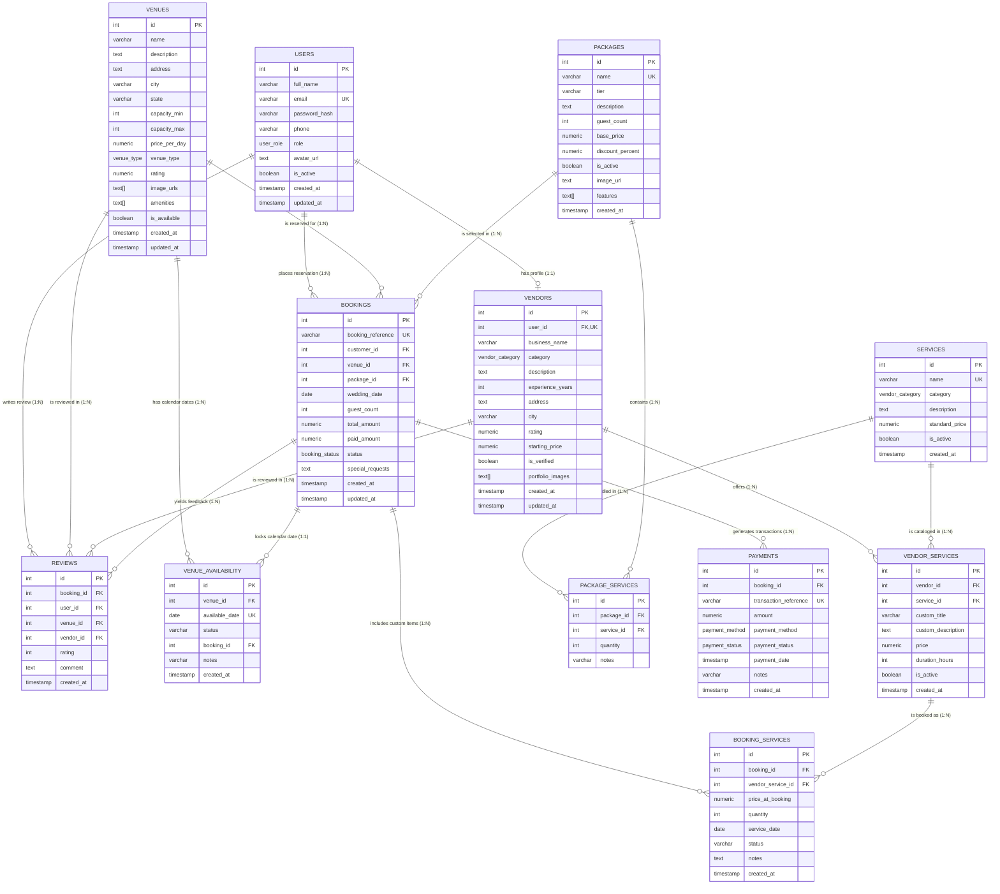

# Entity-Relationship (ER) Diagram & Relational Model
**Project:** Wedding Planning & Booking Management System  
**Course:** Database Management Systems (DBMS) Capstone Group Project  
**Team Members:** Ravi Raj, Manpreet, Perirt, Raj Tripathi  

---

## 1. Visual Entity-Relationship Diagram (Mermaid)

---

## 2. Relational Mapping & Cardinality Summary

| Parent Entity | Child Entity | Cardinality | Foreign Key in Child | Delete Rule | Description |
|---|---|---|---|---|---|
| `users` | `vendors` | 1:1 | `vendors.user_id` | `ON DELETE CASCADE` | Vendor accounts extend base user identities |
| `users` | `bookings` | 1:N | `bookings.customer_id` | `ON DELETE RESTRICT` | Prevents deleting customer with active bookings |
| `venues` | `bookings` | 1:N | `bookings.venue_id` | `ON DELETE SET NULL` | Bookings preserve history if venue archived |
| `venues` | `venue_availability` | 1:N | `venue_availability.venue_id` | `ON DELETE CASCADE` | Calendar dates belong to respective venue |
| `packages` | `bookings` | 1:N | `bookings.package_id` | `ON DELETE SET NULL` | Package selection in wedding contract |
| `vendors` | `vendor_services` | 1:N | `vendor_services.vendor_id` | `ON DELETE CASCADE` | Specific menu or service items offered by vendor |
| `services` | `vendor_services` | 1:N | `vendor_services.service_id` | `ON DELETE RESTRICT` | Standard catalog classification |
| `packages` | `package_services`| 1:N | `package_services.package_id`| `ON DELETE CASCADE` | Package bundles multiple master services |
| `bookings`| `booking_services`| 1:N | `booking_services.booking_id`| `ON DELETE CASCADE` | Custom vendor services assigned to an event |
| `bookings`| `payments` | 1:N | `payments.booking_id` | `ON DELETE CASCADE` | Installment ledger for each booking |
| `users` | `reviews` | 1:N | `reviews.user_id` | `ON DELETE CASCADE` | Reviewer identity tracking |
| `venues` | `reviews` | 1:N | `reviews.venue_id` | `ON DELETE CASCADE` | Reviews submitted specifically for venues |
| `vendors` | `reviews` | 1:N | `reviews.vendor_id` | `ON DELETE CASCADE` | Reviews submitted specifically for vendors |

